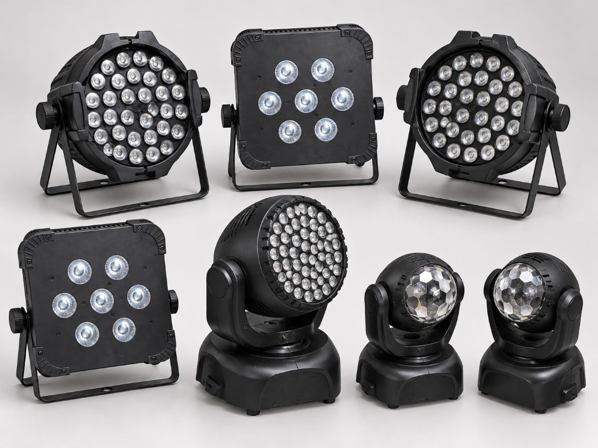

# dmx-fixture-research

<p align="center">
  
</p>

Reverse engineering, DMX channel mappings, documentation, and fixture profiles for vintage and unidentified stage lighting equipment.

The aim is to record measurements and channel maps so other lighting technicians can use the fixtures without repeating the research.

Four fixtures are documented: an RGBWAUV PAR, a U'King pocket moving head, an INVOLIGHT LED moving head, and a DIP-addressed RGB PAR. Each has a channel map, a manual, and a QLC+ profile.

> **Status:** public. The `raw/` folder stays local and is not published.

## Fixture index

<p align="center">
  
</p>

| Fixture | Type | DMX modes | Research status | Folder |
| --- | --- | --- | --- | --- |
| Fixture 01 | LED PAR (RGBWAUV wireless), firmware V2.20 | 7CH verified, 12CH strobe tested | In progress | [fixture-01-led-par](fixtures/fixture-01-led-par/) |
| Fixture 02 | Moving head, ZQ00245001 (label) | 15CH from the reference manual | In progress | [fixture-02-uking-zq00245001](fixtures/fixture-02-uking-zq00245001/) |
| Fixture 03 | Moving head, INVOLIGHT LEDMH100 | 9CH / 11CH from the manufacturer manual | In progress | [fixture-03-involight-ledmh100](fixtures/fixture-03-involight-ledmh100/) |
| Fixture 04 | LED PAR 36× RGB, DIP | 8CH, partly measured | In progress | [fixture-04-led-par-36x-rgb](fixtures/fixture-04-led-par-36x-rgb/) |

The Fixture 01 folder name is still a placeholder. Rename it after identification, for example `fixture-01-led-par` → `rgbwauv-wireless-par`, and update this table. The group photo is an overview, not a measurement of the individual units.

## Layout of each fixture

```text
fixtures/<fixture-id>/
  README.md          — description and technical data
  dmx-channels.md    — channel map for each DMX mode
  test-notes.md      — measurements, quirks, open questions
  manual.md          — operating manual
  photos/            — fixture photos
  profiles/          — control profiles (.qxf, optional .json)
```

### What is recorded

1. **Identification** — photos (front, rear, connectors, rating label, display, and the circuit board if useful), dimensions, LED fit, supply voltage, markings, and likely equivalent models.
2. **DMX channel map** — each mode separately; channel number, function, 0–255 ranges, effect direction, and quirks.
3. **Test results** — values tried, verified versus suspected functions, firmware versions, and differences between units.
4. **Fixture profiles** — importable files for lighting software, starting with QLC+ `.qxf`.

### Channel status

Use one of these states. A value taken from a manual or from the QXF is not **Verified** until it has been checked on the unit.

| Status | Meaning |
| --- | --- |
| **Verified** | Tested and confirmed on the unit |
| **Suspected** | Plausible, but not yet confirmed |
| **Open** | Not yet tested, or not tested well enough |
| **Reference manual** | Printed in a cited manual, not measured on this unit |
| **Profile** | Present only in the QXF |

## Research steps

1. Photograph the fixture (housing, connectors, labels, controls).
2. Identify it (model numbers, equivalent products, manuals).
3. Determine the DMX modes (menu options and channel counts).
4. Test channels systematically and record functions and value ranges.
5. Build a control profile and check the QLC+ file against the fixture.
6. Publish the result (update the README and record open questions).

Single open questions can be GitHub issues (for example, “CH7: effect from DMX value 132 still unclear”) so the fixture page stays readable.

## File formats

| Format | Use | Priority |
| --- | --- | --- |
| `.md` | Description, tables, research notes | Very high |
| `.jpg` / `.png` | Photos, boards, controls | Very high |
| `.qxf` | Importable QLC+ fixture definition | High |
| `.json` | Open Fixture Library | Optional |
| `.pdf` | Project manuals and data sheets | Optional |

## Publication checklist

The repository is public. These items are still open:

- [x] At least one fixture has a verified channel map (Fixture 01, 7CH)
- [x] Project photos are in `fixtures/*/photos/` (no third-party manuals without permission)
- [x] No private paths or personal names in the Markdown
- [ ] `raw/` contains nothing that can be committed (it stays in `.gitignore`)
- [ ] Fixture 01 folder renamed once the manufacturer and model are known
- [ ] GPL-3.0 notice and credits reviewed
- [ ] QLC+ profiles driven live against every fixture (the `.qxf` files are stored; live checks are still open)

## License and contributions

- Repository contents: [GNU General Public License v3.0](LICENSE) (GPL-3.0).
- Upload someone else's manual only with permission. Otherwise link to it.
- Pull requests and issues are welcome for corrections, new fixtures, and unresolved channels.
